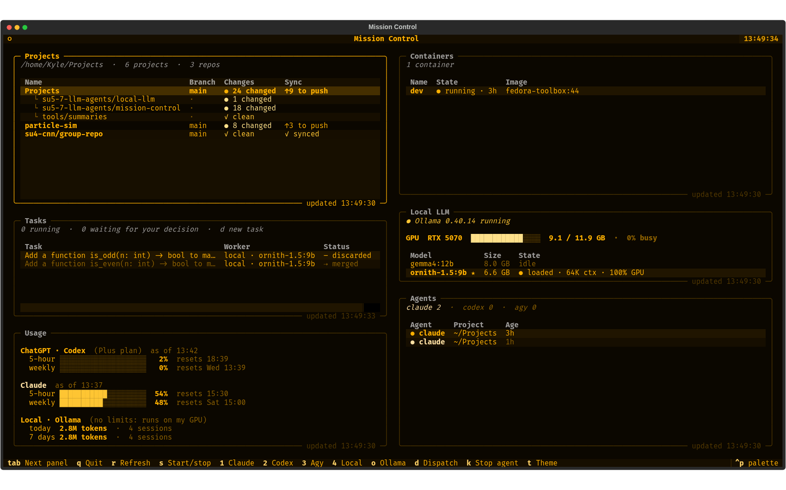
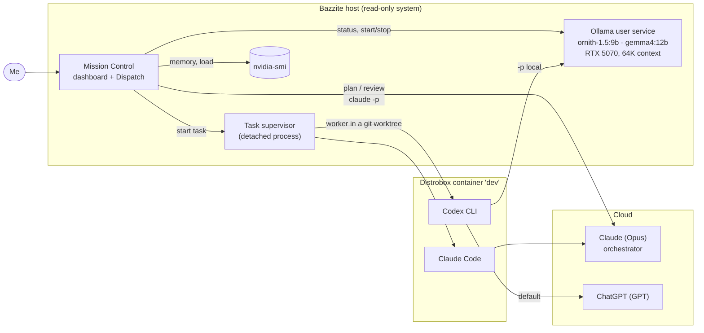
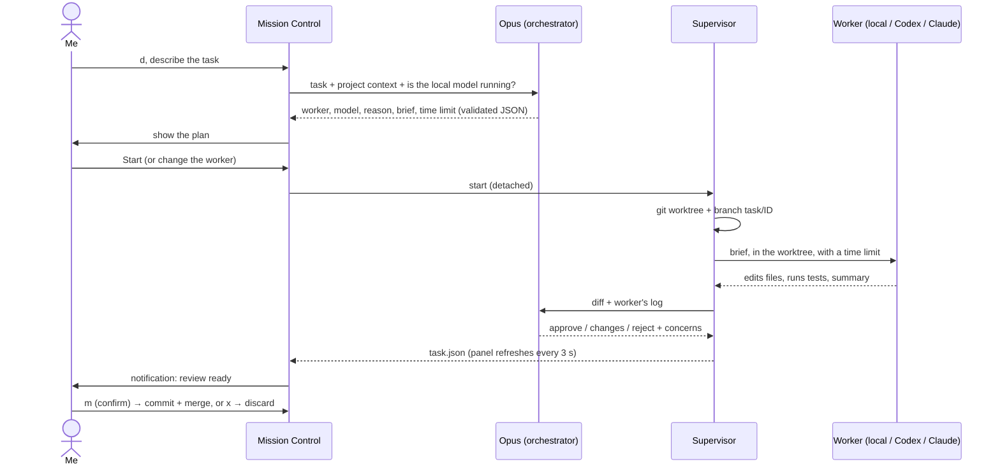
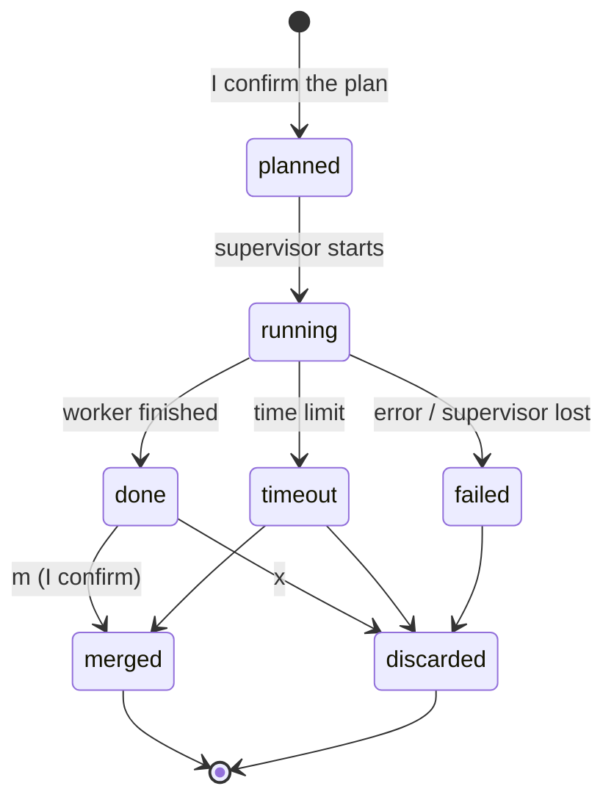
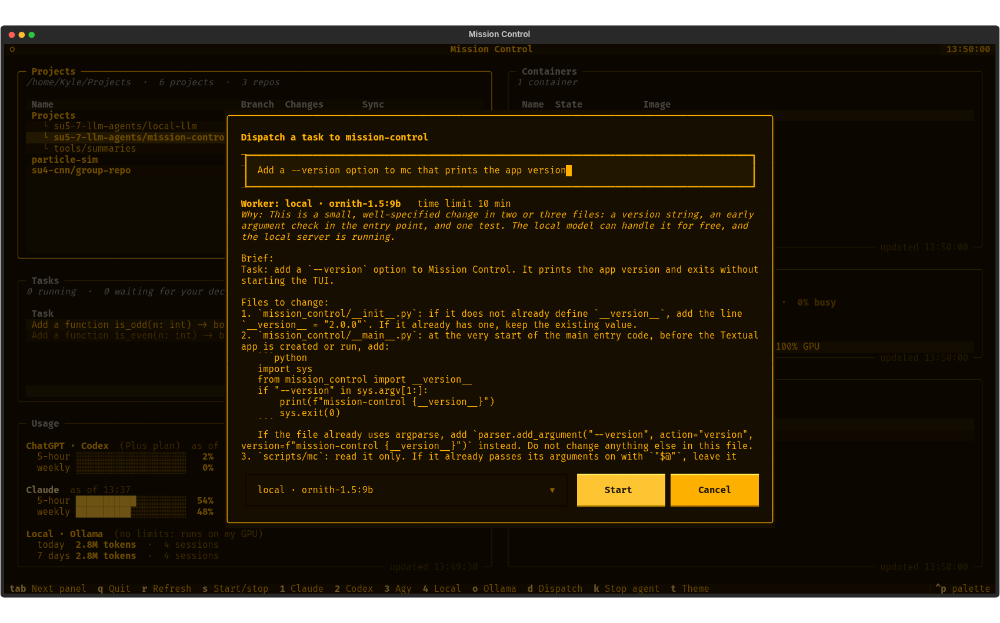

# My agentic coding system: design and development

ITRI626 SU5–7 · checklist item *"System documentation: design and development"*.
How to use it is in [`USAGE.md`](USAGE.md); how I learned along the way is in
[`learning-process.md`](learning-process.md).

## 1. What the system is
A **local LLM** (a 9B model on my RTX 5070) working in a team with two cloud coding agents (Claude Code and
Codex/GPT) on my own projects. **Mission Control**, a terminal dashboard, is the hub: from one screen I see my
containers, projects, agents, the local model and my usage, and I **dispatch** coding tasks. For each task a
strong model (Opus) picks the right worker and writes its instructions, the worker runs unattended in its own
copy of the project, Opus reviews the result, and I decide whether it is merged.

| Part | Folder | What it is |
|---|---|---|
| Environment | [`environment/`](environment/README.md) | Bazzite Linux host, the `dev` container, the three coding agents |
| Local LLM | [`local-llm/`](local-llm/README.md) | Ollama on the GPU, two models, measurements, Codex connected to it, agentic-run evidence |
| Mission Control | [`mission-control/`](mission-control/README.md) | The dashboard and Dispatch (Python 3.14/3.15, Textual), 186 tests |
| Model notes | [`../models/`](../models/README.md) | Every model tried and what I learned from it |

## 2. Requirements
From the ITRI626 checklist and my own decisions:

| # | Requirement | How it is met |
|---|---|---|
| R1 | A system that uses a **local LLM** for **agentic workflows** | Codex CLI drives the local model through Ollama; Dispatch gives it real tasks in its own git worktree ([evidence](local-llm/agentic-runs/)) |
| R2 | One place to see and control everything (the hub) | Mission Control: containers, projects, tasks, agents, local LLM, usage, launch and dispatch |
| R3 | The local model as **team member and fallback**: saves cloud limits, works offline, keeps code private | Routing sends small tasks to it; it runs fully on my GPU; usage shows the tokens it processed |
| R4 | **I stay in control** | Nothing starts before I confirm a plan; nothing is merged before I confirm; workers can't touch the main checkout |
| R5 | Fits the hardware: **12 GB VRAM**, immutable Linux | Models chosen and context sized to stay 100% on the GPU; nothing installed into the read-only system |
| R6 | Everything documented and measured | READMEs per part, a log of every decision and problem, saved logs of agent runs |

## 3. Architecture

**Why it is split like this:**
- **Host vs container.** Bazzite's system is read-only, so development tools live in the `dev` container
  ([environment](environment/README.md)). The model server runs **on the host** instead: `dev` has no NVIDIA
  libraries, and Ollama ships its own CUDA, so it needs nothing installed. Codex in `dev` reaches it at
  `localhost:11434` because Distrobox shares the network.
- **Mission Control runs on the host**, not in `dev`: a program started through `distrobox enter` keeps running
  invisibly when its window is closed (podman's `conmon` keeps the terminal open). On the host it can also see
  every process and use podman directly.
- **Workers run in `dev`**, where Codex is installed, each in its own git worktree, under a supervisor process
  that is independent of the dashboard.

### Mission Control's modules
No module except `app.py`, `panels.py` and `dialogs.py` imports the UI library, so every data source can be
tested on its own.

| Module | Lines | Job |
|---|---|---|
| `app.py` | 410 | Layout, refresh timers (background threads), keys and actions |
| `panels.py` / `dialogs.py` / `app.tcss` | 637 / 167 / 222 | The panels, the Dispatch dialog, task view and confirm dialog; styles |
| `gitinfo.py` | 194 | Finds the projects in `~/Projects` and their git status |
| `containers.py` | 129 | Distrobox containers via podman, start/stop with self-protection |
| `agents.py` | 313 | Running agent sessions from `/proc`, their project, local-model sessions; stopping orphans |
| `usage.py` | 253 | Plan limits (Codex logs, Claude's cache) and the local model's tokens |
| `localllm.py` | 261 | Ollama API and `nvidia-smi` parsing; starting/stopping the Ollama service |
| `launcher.py` | 65 | Opens an agent in a new Konsole window in the selected project |
| `orchestrator.py` | 250 | Opus planning and review: routing rules, prompts, JSON schemas, validation |
| `tasks.py` | 391 | Task records, the supervisor, worker commands, merge/discard |
| `worktrees.py` | 182 | The git layer: create worktree, summarise changes, commit, merge, remove |
| `cli.py` | 174 | `mc task ...`: Dispatch from the command line |
| `themes.py`, `settings.py` | 187, 46 | Four colour themes; the saved choice |

## 4. Dispatch: the agentic workflow
The design is **orchestrator–workers**: a strong model plans and checks, cheaper or more specialised models
do the work, and I make the decisions that matter.

**Routing rules** (in `orchestrator.py`; the cheapest worker that will very likely succeed):

| Worker | Gets | Time limit | Why |
|---|---|---|---|
| **local** (`ornith-1.5:9b` / `gemma4:12b`) | Small, single-step, well-specified tasks in 1–2 files; only when Ollama is running. Brief: short, exact files, "write first, then test, then fix" | 10 min | Measured: it looped without acting on a 9-function task, but did 1-function tasks in about a minute |
| **codex** (GPT) | Well-specified multi-file work | 25 min | Measured: built the git layer in 3 minutes with no fixes needed |
| **claude** (Claude Code) | Ambiguous, design-heavy or cross-cutting work | 25 min | Best judgement; the most expensive |

**Design choices inside Dispatch:**
- **Opus is called with `claude -p --tools "" --json-schema ...`**: no tools (it only plans), and the reply must
  match a schema, so the plan is machine-checked. The plan is also checked against reality: the local model
  can't be chosen while Ollama is off, and an unknown model falls back to the default.
- **One git worktree per task**: a second checkout of the repo on its own branch. The worker can't touch my
  main checkout; Codex workers are sandboxed to the worktree (`-s workspace-write`). Discarding a task deletes it
  without a trace.
- **A detached supervisor** runs the worker, so tasks survive closing the dashboard. A supervisor that dies
  (for example on a reboot) is noticed and its task marked failed.
- **Time limits at two levels:** `timeout` in the container, and the supervisor kills the worker 60 s later.
- **Opus reviews every change** before I see it. It reads the diff and the worker's log; it doesn't run code.
- **Everything is a file** (`~/.local/state/mission-control/tasks/<id>/`): the dashboard, the CLI and the
  supervisor share state without a server or database, and a task can be inspected with `cat`.
- **Decisions are logged** (`decisions.jsonl`) for transparency, **not for training**: Anthropic's and OpenAI's
  terms forbid training models on their output.

## 5. Key design decisions
| Decision | Alternatives considered | Why this one |
|---|---|---|
| **Ollama unpacked into `~/.local`, run as a user service** | Ollama in a GPU-enabled podman container | No GPU passthrough on an immutable system, nothing touches `/usr`, easy to update or remove ([details](local-llm/README.md#how-to-install-ollama-on-bazzite-options)) |
| **Codex CLI with a `local` profile** as the agent for the local model | Other agent tools | Already installed and familiar; supports Ollama; a profile keeps the normal GPT setup unchanged |
| **64K context, models that fit 100% on the GPU** | Bigger models (`gpt-oss:20b`), 128K context | Measured: at 128K both models spill into RAM; Codex needs ≥ 64K (it sent 27K tokens for a fizzbuzz task) |
| **`ornith-1.5:9b` as default local model** | `gemma4:12b` (faster) | Built for agentic coding, more VRAM headroom, didn't loop; gemma stays as the fast option |
| **Server started by hand** (`o` in the dashboard) | Autostart at login | Keeps the GPU free for other work |
| **Mission Control on the host, own venv per Python version** | Run it in `dev` | Avoids orphaned processes; the host and `dev` have different Python versions, so `mc` picks the venv that works |
| **Orchestrator–workers with Opus** | The local model routing on its own; me routing by hand | Opus gives good briefs and reviews today; a fine-tuned local router can take over the routing step later (§8) |
| **Owner confirms plan and merge** | Fully automatic | Agents make mistakes (§6); a human gate keeps the main checkout safe |
| **One portfolio repo**, projects as folders | One repo per project | One place for the lecturer; old histories merged in, nothing lost |

## 6. How it was built
### Timeline
| Date | Work |
|---|---|
| 2026-11-03 | Environment: Bazzite, `dev` container, Claude Code, Codex, Antigravity (after Gemini CLI stopped working for personal accounts). Mission Control v1: projects, containers, agents, usage, launch, stop-agent, themes, `mc` launcher |
| 2026-11-05 | Local LLM: Ollama install, two models, context/GPU tests, coding test, Codex connected |
| 2026-11-18 | Portfolio restructure. Mission Control v2: projects panel for the one-repo layout, Local LLM panel, local agents, local usage, Dispatch. Local-model agentic runs, GPT comparison, end-to-end Dispatch tests |

### A multi-agent team built it
The system was built the way it works: Claude Code planned, built the core and reviewed; parts were delegated
to other agents in their own git worktrees, always with my approval, and every delegated change was reviewed
with `git diff` before merging. Each README has a "Who built what" table; in short:

| Agent | Built |
|---|---|
| Claude Code (Opus) | Most of Mission Control, the local-LLM setup and measurements, the orchestrator and supervisor, all reviews and documentation |
| Codex with GPT models (default, GPT-6 Astra, GPT-6.1 Sol) | App skeleton, Containers panel, launch actions (in parallel with Claude), `mc` launcher, Dispatch's git layer |
| **My local model** (`ornith-1.5:9b`) | `localllm.py`'s parsing functions and tests (second attempt; one bug fixed in review) ([write-up](local-llm/agentic-runs/2026-11-18-localllm/README.md)) |

### Testing
- **186 unit tests**, run on the host and in `dev` (the app must work in both). Everything outside the program is
  mocked or temporary: podman, `/proc`, Ollama, `nvidia-smi`, `systemctl`, the orchestrator, git repos, the
  settings and task folders. No test can touch my real projects or files.
- **Screenshot checks** of the real app with real data after every UI change: unit tests can't see layout
  problems (overflowing or duplicated columns were found this way three times).
- **End-to-end runs** of Dispatch in a throwaway repo: plan, run, review, merge and discard
  ([evidence](local-llm/agentic-runs/2026-11-18-dispatch-e2e/README.md)).

### Problems found and how they were solved
| Problem | Found by | Solution |
|---|---|---|
| Agents kept running invisibly after their window closed (podman's `conmon`) | Mission Control showed 3 orphans | Stop-agent key; Mission Control itself runs on the host |
| Ollama loads models with a 4K context; Codex needs ≥ 64K | Server log | `OLLAMA_CONTEXT_LENGTH=65536` in the service, after measuring GPU fit |
| `gemma4:12b` looped forever at temperature 0 with thinking on | Coding test | Use each model's default temperature |
| `ollama ps` under-reports gemma's memory (it shows the draft model) | Comparing with `nvidia-smi` | The Local LLM panel takes GPU memory from `nvidia-smi` |
| Projects panel broke when `~/Projects` became one repo | Screenshot | Projects = folders with their own `CLAUDE.md`/`AGENTS.md`, or separate repos; changes counted per folder |
| A host update (Python 3.15) silently broke `mc` on the host | Testing the launcher | A second venv for the host; `mc` uses whichever works |
| A test depended on today's date | It failed on 2026-11-18 | The reader takes the time as a parameter |
| The local model looped on a large task and wrote nothing | Its log ("let me write…" ×42) | Smaller tasks, time limits, routing rules |
| Local Codex runs hid my real ChatGPT limits | Screenshot ("unknown") | Skip plan-limit entries that contain no limits |
| Running tests in a worker created `.pyc` files that would be merged | **Opus's review** | Workers run with `PYTHONDONTWRITEBYTECODE=1` |
| Merge commits named the AI worker | End-to-end test | Commit messages are `Task <id>: <title>`; who did it stays in the task record |

## 7. Limitations
- **The local model is weak at multi-step agentic work.** It is only routed small tasks, and every result is
  reviewed. On a task the size of a module, a cloud model is far better
  ([comparison](local-llm/agentic-runs/2026-11-18-worktrees-gpt/README.md)).
- **The review doesn't run the code**; it relies on the diff and on the worker's own test run in its log.
- **Planning and review use my Claude plan** (about 10–30 s and a small amount of usage per call). Without a
  connection I can still choose a worker myself, but there is no review.
- A worktree starts from the **last commit**: uncommitted changes in the main checkout aren't in it.
- Workers that need a Python environment use the main checkout's `.venv` (worktrees don't have one).
- Cosmetic: the Containers panel sometimes draws squashed on startup and corrects itself within 10 s.

## 8. Future work
1. **Fine-tune the router** so the routing step runs on the local model (free, offline, private), with Unsloth:
   once in Google Colab and once on the RTX 5070, exported to GGUF and loaded into Ollama, then compared with the
   base model on held-out tasks. The training labels must come from me, an open-weight teacher whose license
   allows it, or rules, **never from Claude or GPT** (their terms forbid it).
2. Try the local model with lower reasoning effort (`-c model_reasoning_effort=low`), which may reduce the looping.
3. Let the review run the project's tests in the worktree.
4. Split large tasks into steps automatically, so more of them fit the local model.
