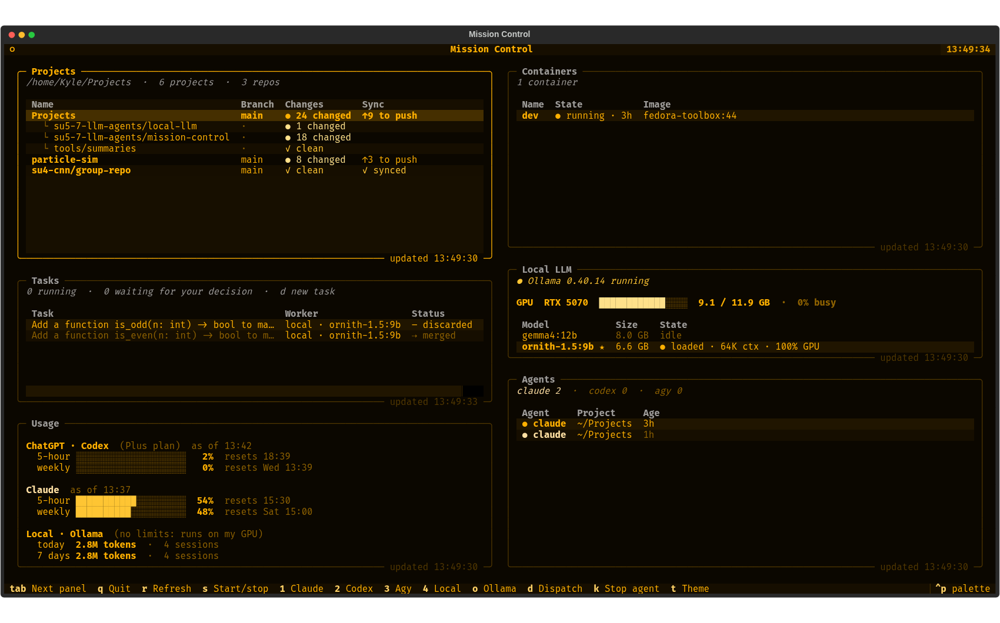
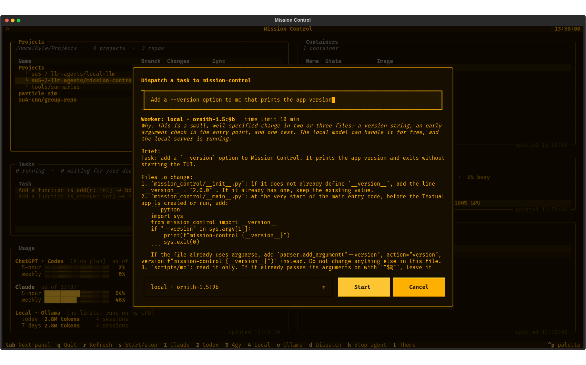

# My agentic coding system: how to use it

ITRI626 SU5–7 · checklist item *"System documentation: usage instructions"*.
How it is designed and built is in [`DESIGN.md`](DESIGN.md).

## 1. What you need
| | |
|---|---|
| Computer | Linux (I use Bazzite 44, KDE) with an NVIDIA GPU; 12 GB VRAM fits the models below |
| Accounts | Claude (for Claude Code and the orchestrator), ChatGPT (for Codex), optionally Google (Antigravity) |
| Disk | ~15 GB for Ollama and two models |

## 2. One-time setup
Each step is documented in full, with every command and problem, in the folder it links to.

1. **Development container and agents** ([environment](environment/README.md)): create the `dev` container,
   install Node.js, Codex (`npm install -g @openai/codex`) and the GitHub CLI in it; install Claude Code and
   Antigravity into `~/.local/bin`. Log in to each agent once.
2. **Local LLM** ([local-llm](local-llm/README.md)):
   - Unpack the Ollama release into `~/.local` (checksum verified) and add the user service
     `~/.config/systemd/user/ollama.service` with `OLLAMA_CONTEXT_LENGTH=65536`.
   - `systemctl --user start ollama`, then `ollama pull ornith-1.5:9b` and `ollama pull gemma4:12b`.
   - Add the Codex profile `~/.codex/local.config.toml` (`model_provider = "ollama"`,
     `model = "ornith-1.5:9b"`, `model_context_window = 65536`).
3. **Mission Control** ([mission-control](mission-control/README.md#setup)):
   ```bash
   # In dev: the venv used for tests and for running inside dev
   distrobox enter dev
   cd ~/Projects/su5-7-llm-agents/mission-control
   python3 -m venv .venv && .venv/bin/pip install -r requirements.txt
   exit
   # On the host: the venv mc normally uses
   cd ~/Projects/su5-7-llm-agents/mission-control
   python3 -m venv .venv-host && .venv-host/bin/pip install -r requirements.txt
   ./scripts/install.sh        # adds the `mc` command and a KDE menu entry
   ```
4. **Claude's usage numbers:** run `/usage` once in Claude Code so Mission Control can show them.

## 3. Starting
Type **`mc`** in any terminal, or open **Mission Control** from the KDE menu (Development). It refreshes by
itself (every 3–60 s depending on the panel); **`r`** refreshes everything now. Quit with **`q`**.



| Panel | Shows |
|---|---|
| **Projects** (top left) | The portfolio repo and every project in it, plus separate repos: branch, changed files, commits to push |
| **Tasks** | Dispatched tasks: worker, progress, changed files, Opus's review |
| **Usage** | ChatGPT and Claude plan limits (5-hour and weekly), and tokens the local model processed |
| **Containers** (top right) | Distrobox containers and their state |
| **Local LLM** | Is Ollama running, GPU memory, installed models (★ = default), which is loaded |
| **Agents** | Running Claude, Codex and Antigravity sessions and their project; local-model sessions show their model |

## 4. Keys
| Key | Does | Where |
|---|---|---|
| `Tab` | Next panel | everywhere |
| `↑` `↓` | Select a row | in a panel |
| `1` `2` `3` | Open Claude Code / Codex / Antigravity in the selected project (new window) | Projects selected |
| `4` | Open Codex on the **local model** selected in the Local LLM panel | Projects selected |
| `d` | **Dispatch** a task to the selected project | Projects selected |
| `o` | Start Ollama; stop it (asks first) | everywhere |
| `s` | Start/stop the selected container | Containers |
| `k` | Stop the selected agent session (asks first) | Agents |
| `v` `m` `x` | View / merge / discard the selected task (merge and discard ask first) | Tasks |
| `t` | Next colour theme (saved) | everywhere |
| `r` / `q` / `Ctrl+P` | Refresh / quit / command palette | everywhere |

In every confirmation dialog **No has focus**, so Enter never confirms by accident: press **`y`** for yes.

## 5. Working with the local model
1. **Start it:** press **`o`**. After a few seconds the Local LLM panel shows `● Ollama … running`.
   (Terminal: `systemctl --user start ollama`.)
2. **Pick a model** in the Local LLM panel: `ornith-1.5:9b ★` (default, built for agentic coding) or
   `gemma4:12b` (faster).
3. **Open it on a project:** select the project, press **`4`**. A Codex window opens on the local model; the Agents
   panel shows `● codex · <model>`. (Terminal: `codex -p local` inside `dev`, or `codex -p local -m gemma4:12b`.)
4. **Stop it when done:** press **`o`** and confirm. This frees the GPU.

**What to give it:** small, clear jobs in one or two files: a function, a test, a bug with a known cause,
docstrings, explanations. Name the files and say exactly what you want. For bigger jobs use Codex or Claude, or
let Dispatch choose.

## 6. Dispatching a task
1. **Commit first** if the task depends on recent changes: the worker gets a copy of the last commit.
2. Select the project in the Projects panel and press **`d`**.
3. Describe the task and press **Enter**. After 10–30 s Opus shows its **plan**: which worker, why, the time limit
   and the brief the worker will get.
   
4. Press **Start**. To use another worker, choose it in the list first (Opus's brief is kept). If planning fails
   (no connection, limits reached), choose a worker yourself; the task text becomes the brief.
5. The task appears in the **Tasks** panel: `● running 2m / 10m`. You can close Mission Control meanwhile; the task
   keeps running.
6. When it finishes you get a notification, and shortly after, **Opus's review**: `✓ approve`, `△ changes` or
   `✗ reject`.
7. Select the task and press **`v`** to read the review, the changed files, the worker's summary and the diff.
8. Decide:
   - **`m` merge**: commits the changes on the task's branch and merges them into your project (asks first). If it
     conflicts with your own changes, nothing is changed and you're told which files conflict.
   - **`x` discard**: deletes the task's copy and branch. Your project is unchanged.

A task that ran out of time (`⏱ timeout`) or failed can still be viewed, and merged if the partial work is useful.

### From the command line
Run in the project folder (or add `--project <folder>`):
```bash
mc task start "add a --version option to mc"          # Opus plans, you confirm with y
mc task start "fix the typo in README" --agent local  # choose the worker yourself (local, codex, claude)
mc task start "..." --dry-run                         # only show Opus's plan
mc task list                                          # recent tasks, status and review
mc task show <id>                                     # everything about one task
mc task diff <id>                                     # the changes
mc task merge <id>     mc task discard <id>           # add -y to skip the question
```

## 7. Troubleshooting
| Problem | Fix |
|---|---|
| `Note: no venv works on the host, so Mission Control runs inside dev` | A system update changed the host's Python. Rebuild: `rm -rf .venv-host`, then step 3 of the setup. Until then, quit with `q` (closing the window would leave it running in `dev`) |
| Ollama won't start (`o` reports an error) | `systemctl --user status ollama` and `journalctl --user -u ollama -n 50` |
| A model loads but is slow; State shows less than `100% GPU` | Part of it spilled into RAM: close other GPU programs, or use the smaller model |
| Usage shows `unknown` or `no cached usage yet` | Run a Codex task (it logs its limits) or `/usage` in Claude Code |
| An agent keeps running after its window was closed | Select it in Agents, press `k`. Habit: quit agents with `/quit` (Codex) or `/exit` (Claude) |
| Dispatch: `Planning failed` | Check that `claude -p "hi"` works in a terminal (logged in, limits left), or choose a worker yourself |
| A task shows `failed`: *the supervisor process stopped unexpectedly* | The computer was restarted during the task. Discard it and dispatch again |
| Merge says `Merge conflict in: …` | Your project changed the same lines. Nothing was merged; commit or undo your changes, or discard the task |
| The local model runs out of time on a task | The task is too big for it: dispatch it to Codex or split it |

## 8. Where things are
| What | Where |
|---|---|
| Dispatched tasks (record, log, diff, review) | `~/.local/state/mission-control/tasks/<id>/` |
| Routing decisions | `~/.local/state/mission-control/decisions.jsonl` |
| Task worktrees (removed on merge/discard) | `~/Projects/.worktrees/task-<id>/` |
| Mission Control settings (theme) | `~/.config/mission-control/settings.json` |
| Local models | `~/.ollama/models` (not in git: 5–15 GB each) |
| Ollama program and service | `~/.local/bin/ollama`, `~/.local/lib/ollama`, `~/.config/systemd/user/ollama.service` |
| Codex local profile | `~/.codex/local.config.toml` |
| Codex session logs (usage numbers come from here) | `~/.codex/sessions/` |
